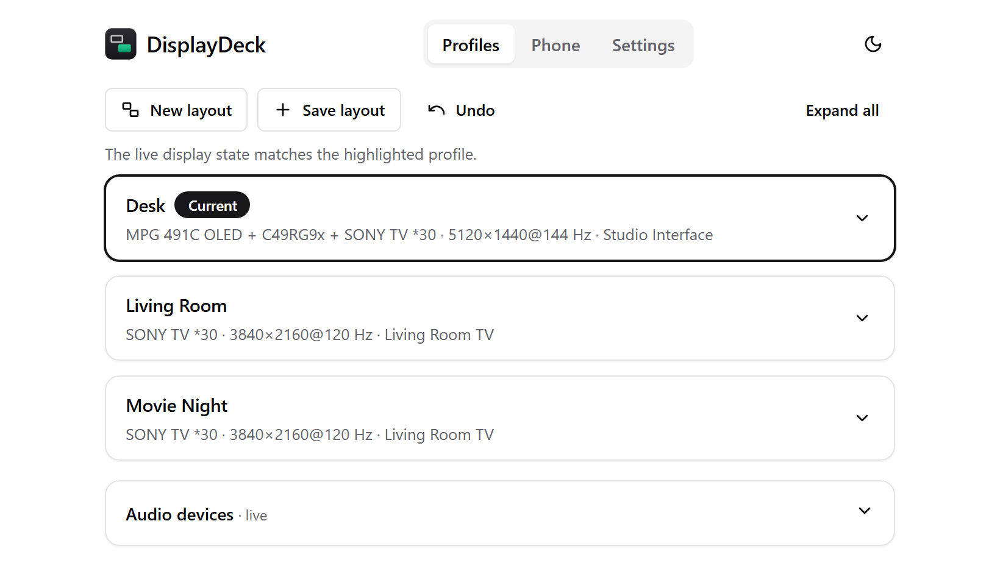
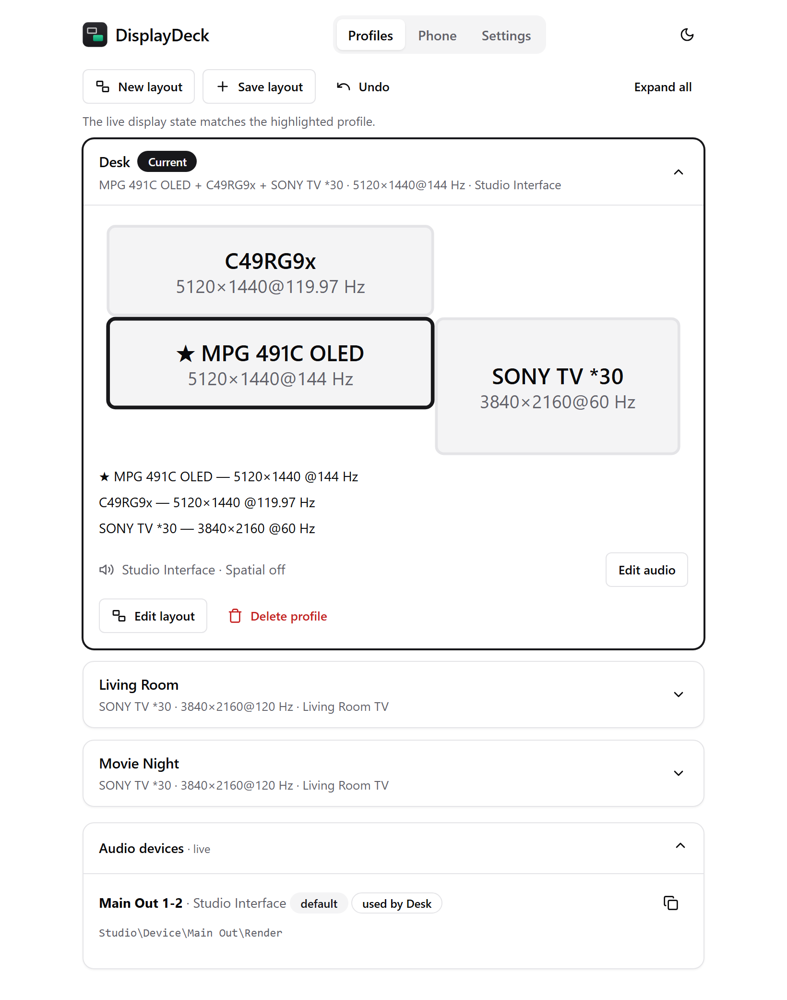
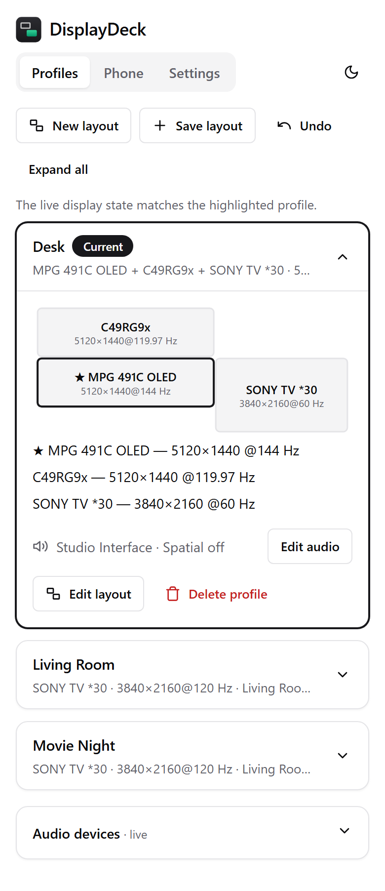
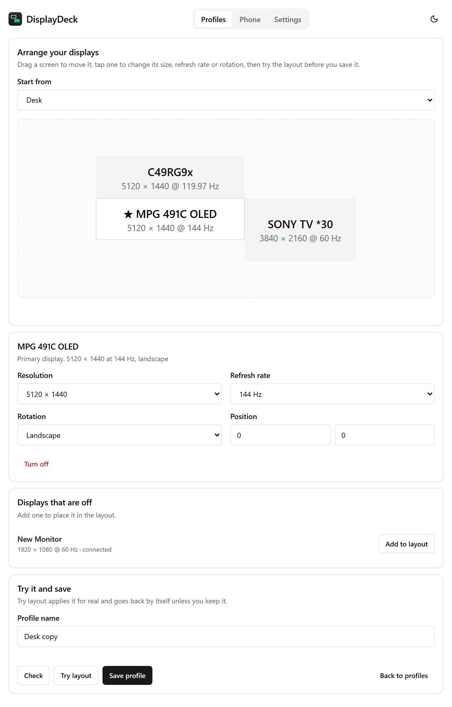
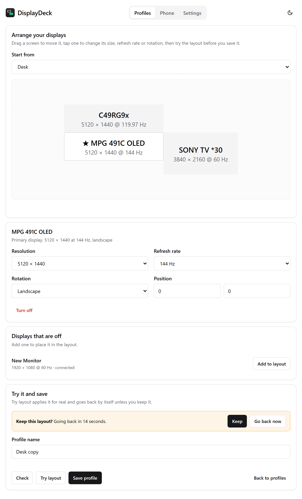
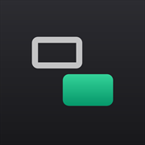
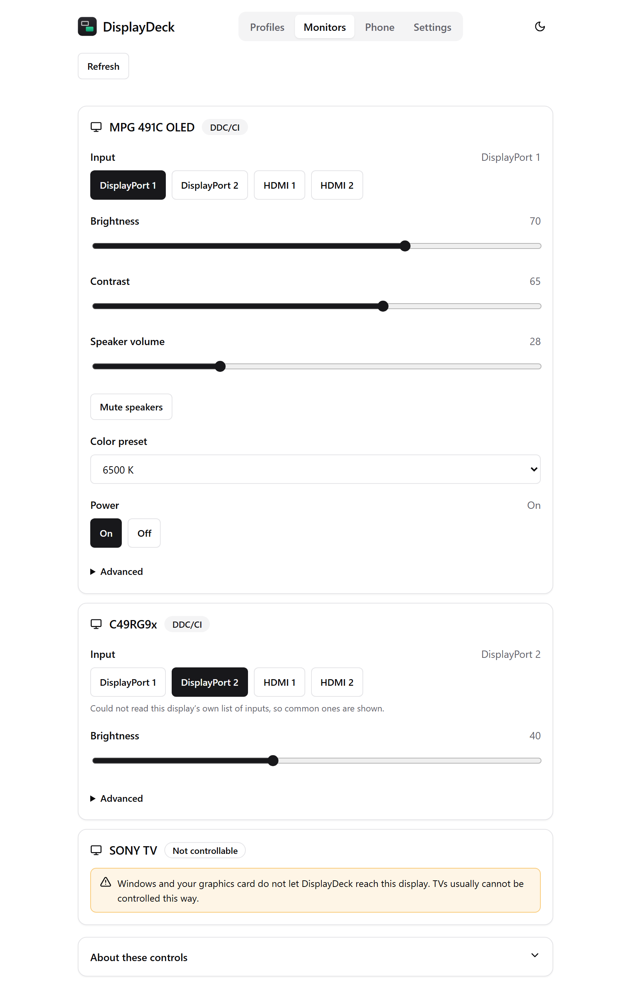

# DisplayDeck

**Switch your whole desk setup with one tap.** DisplayDeck saves your monitor layouts and audio devices
as named profiles ("Desk", "Living Room", "Den TV") and puts them behind a tray icon and a phone-friendly
web page. One click on the PC, or one tap on your phone, and the screens, the sound output and the
spatial format all change together.

It is a single self-contained app: nothing else needs to be downloaded or installed.

It is free and made in spare time. If it saves you a few clicks, a [coffee](https://buymeacoffee.com/notpunny) is always appreciated, and never expected.

## What it does

- **Save the layout you have right now.** Arrange your monitors in Windows the way you like, then press
  **Save current layout** and give it a name. DisplayDeck records which displays are on, their
  arrangement, resolution and refresh rate.
- **One card per profile.** Each card shows which displays are on or off, each display's resolution and
  refresh rate, the primary display, and a to-scale preview of the layout.
- **Knows what is active.** It compares the live display state with every profile and marks the matching
  card **Current**. If nothing matches reliably it falls back to **Last applied** rather than guessing.
- **Compact cards.** Each profile is a one-line card you can tap to apply. A chevron expands it to show the
  preview, the displays and the audio settings, and **Expand all / Collapse all** handles the lot. Your
  choices are remembered.
- **Build and edit layouts.** Drag your screens around on a canvas, turn displays on or off, pick each one's resolution,
  refresh rate and rotation, and choose the primary display. Start from a saved profile ("Duplicate and edit"), from the
  screens as they are now, or from a blank canvas. **Try layout** applies it for real and goes back by itself unless you
  keep it.
- **Monitor controls.** A **Monitors** tab talks to the monitors themselves over their DisplayPort or HDMI cable
  (DDC/CI): switch a monitor's input (DisplayPort 1 or 2, HDMI 1 or 2), set brightness, contrast, speaker volume and
  mute, pick a color preset, and turn it on or off. It works from your phone too.
- **Undo.** Every layout change remembers the previous layout, so **Undo layout change** takes you back.
- **Audio goes with the profile.** Give each profile a playback device and a spatial format (Off, Windows
  Sonic, Dolby Atmos, DTS, ...). Both switch together. The format list is read from the device itself, so
  you only see what that device supports.
- **Tray icon.** Left-click opens the page. Right-click lists your profiles so you can apply one without
  opening a browser. It can start with Windows.
- **From your phone.** Turn on **Allow other devices** in the tray menu, scan the QR code, and you have the
  same page on your phone, protected by a private access key and limited to your home network. Add it to your iPhone or Android home screen and it opens like an app, with its own icon.
- **Friendly names.** Monitors are named from the profile, falling back to the Windows EDID name or a short
  ID, and you can override any name.
- **Stream Deck.** An optional plugin puts profile, next-profile, undo and audio-output keys on your Stream Deck.
  The profile and audio keys light up when they are the active one. See [Stream Deck](#stream-deck).
- **HomeKit.** A [Homebridge plugin](https://github.com/NPLAudio/homebridge-displaydeck) gives every profile its own HomeKit switch. Install and setup steps are in the [plugin's README](https://github.com/NPLAudio/homebridge-displaydeck#install). See [HomeKit (Homebridge)](#homekit-homebridge).
- **Three pages.** Profiles, Phone (the QR code) and Settings each have their own page, reachable from the
  tabs at the top or from the tray menu.
- **Light and dark.** The interface uses [shadcn/ui](https://ui.shadcn.com) design tokens (zinc theme),
  follows your system's light or dark setting, and has a toggle. To re-theme, paste a theme from
  [ui.shadcn.com/themes](https://ui.shadcn.com/themes) over the two token blocks at the top of
  `web/public/app.css`.

## Install

Download `DisplayDeck-<version>.msi` from the
[latest release](https://github.com/NPLAudio/DisplayDeck/releases/latest) (or build it yourself, see
[Build from source](#build-from-source)), run it, and accept the administrator prompt. DisplayDeck starts
in the notification area and opens its page.

See **[INSTALL.md](INSTALL.md)** for the full walkthrough, phone setup, troubleshooting and uninstalling.

Requirements: Windows 10 or 11 (64-bit).

## A quick tour

The screenshots use made-up profiles and devices.

### 1. Save your first layout

1. Arrange your monitors in Windows the way you want them.
2. Right-click the DisplayDeck tray icon and choose **Save current layout...** (or press **Save layout** on the page).
3. Type a name, such as "Desk", and confirm. Repeat for each arrangement you use.



Each saved layout is one card. The highlighted card marked **Current** is the one that matches your screens right now.

### 2. Apply a profile

- On the PC: left-click the tray icon to open the page and tap a card, or right-click the tray icon and pick a profile from the menu.
- On your phone: see [Use it from your phone](INSTALL.md#4-use-it-from-your-phone-optional).
- On a Stream Deck: see [Stream Deck](#stream-deck).

Applying a profile switches the displays and, if the profile has audio settings, the sound output too.

### 3. Look inside a card, and set its audio

1. Press the arrow on the right of a card to expand it. You see a to-scale preview of the layout, each display's resolution and refresh rate, and the audio settings. The star marks the primary display.
2. Press **Edit audio** to pick a playback device and a spatial format. The list shows only what that device supports.
3. The **Audio devices** card at the bottom lists every playback device right now, and which profiles use it.



On a phone the same page fits the screen:



### 4. Changed your mind?

Press **Undo** at the top of the page (or **Undo layout change** in the tray menu) to go back to the previous layout.

## How it works

DisplayDeck is a small local web server (Node, no npm dependencies), a tray program, and a helper that talks
to Windows:

```
ctl/         DisplayDeckCtl.exe source: display layouts (QueryDisplayConfig / SetDisplayConfig) and audio devices (Core Audio)
tray/        DisplayDeck.exe source: tray icon, menu, starts the server, firewall prompt
web/         the server and the page; parses profile files and runs the helper
streamdeck/  the Stream Deck plugin (TypeScript, built with Node 24)
brand/       the icon drawing code (app icon, tray, installer, plugin icons)
installer/   build scripts and the WiX definition for the MSI
```

- A profile is an XML file in the profiles folder (`%APPDATA%\DisplayDeck\Profiles` by default). It holds
  the display paths and modes that were active when you saved it. Applying one remaps it onto the current
  graphics adapters (their ids change between boots), asks Windows to validate and apply it, and reports any
  display that is not connected instead of failing.
- Audio settings live next to each profile as `<profile>.audio.json`, for example:

  ```json
  { "label": "Living room TV",
    "device": "NVIDIA High Definition Audio\\Device\\SONY TV  *30\\Render",
    "spatial": "Dolby Atmos for Home Theater" }
  ```

  `device` is the id shown on the page and `spatial` is a format name, or `"off"`.
- The page re-scans the profile folder every time it loads, so new or edited profiles appear without
  restarting anything.
- The profile file format and the HTTP API are documented in [web/README.md](web/README.md).

### 5. Build or edit a layout

You don't have to arrange your monitors in Windows first. The layout editor does it for you.

1. Press **New layout** at the top of the Profiles page to start from a blank canvas, or open a card and press **Edit layout** to start from a copy of that profile.
2. Drag the screens into place. Edges snap together, and a red outline means two screens overlap.
3. Tap a screen to change its resolution, refresh rate or rotation, make it the primary display, or turn it off. Displays that are off appear in a list underneath, with an **Add to layout** button.
4. Press **Check** to ask Windows whether it accepts the layout, without changing anything.
5. Press **Try layout** to see it for real. A banner counts down 15 seconds and the screens go back to how they were unless you press **Keep**. If a layout leaves your screens blank, just wait.
6. Type a name and press **Save profile**. Editing a copy keeps the original's audio settings.





A display that is switched off right now can't list its exact modes, so the editor offers the sizes your saved profiles used and some common ones. **Check** and **Try layout** confirm that Windows accepts your choice. The editor only works from the PC itself, not from a phone.

### 6. Put it on your phone's home screen



On an iPhone or iPad (iOS 16.4 or newer):

1. Turn on **Allow other devices (phone)** in the tray menu, then choose **Show phone QR code**.
2. Scan the code with the **Camera** app and open the link in **Safari**.
3. Tap the **Share** button, scroll down and tap **Add to Home Screen**, then **Add**.
4. Open **DisplayDeck** from your home screen. It runs full screen, like an app.

On Android, open the link in Chrome, tap the menu and choose **Add to Home screen**. The Phone page in DisplayDeck shows the same steps.

### 7. Switch a monitor's input and other controls

The **Monitors** tab is the remote control for your screens: the same things as the buttons on a monitor's front panel, sent over its cable.



1. Open the **Monitors** tab. Each display that is on in Windows gets a card.
2. Tap an **Input** button, such as **HDMI 1**, to switch that monitor to it. DisplayDeck asks you to confirm, because the screen goes blank here if nothing (or another computer) is on that input.
3. Drag the **Brightness**, **Contrast** and **Speaker volume** sliders, press **Mute speakers**, or choose a **Color preset**.
4. Use the **Power** buttons to turn a monitor on, or off.

The buttons come from what each monitor says it supports, so you only see inputs and presets it really has. On this PC, **Advanced** shows the monitor's full feature list and lets you read or send any other DDC/CI command.

Good to know:

- Most monitors support this. Some have a **DDC/CI** switch in their on-screen menu that has to be on.
- TVs usually do not listen for these commands. They use HDMI-CEC, which a PC can only send with extra hardware, so they show as **Not controllable**.
- Once a monitor is switched to an input from another device, this PC can no longer reach it. Switch it back with its own buttons or from the other device.
- Some monitors only implement DDC/CI on certain ports. Several Samsung ultrawides, for example, answer on HDMI but not on DisplayPort: they accept the commands and report the new values, yet nothing changes on screen, so DisplayDeck shows a warning and hides their controls. Use such a display on HDMI.
- Some monitors number their inputs differently from the standard, so use the monitor's own list (shown automatically) rather than guessing.
- Some monitors answer unreliably, for example by repeating their last reply when asked for their power state. DisplayDeck double-checks what it can and hides a reading it cannot trust, but still offers the buttons if the monitor lists the feature.
- Windows refuses to hand out controls for some NVIDIA-driven displays, so DisplayDeck talks to those through the graphics card directly. This uses a file the NVIDIA driver already provides; nothing extra is installed.

## HomeKit (Homebridge)

The [homebridge-displaydeck](https://github.com/NPLAudio/homebridge-displaydeck) plugin adds one HomeKit switch for every saved profile, so "Hey Siri, turn on Living Room" or a Home app automation can switch your screens and sound. The switches appear and disappear on their own as you add and delete profiles, and the active profile's switch reads on. It needs **Allow other devices (phone)** turned on, and the access key from the Phone page link. **Install and setup instructions: [NPLAudio/homebridge-displaydeck](https://github.com/NPLAudio/homebridge-displaydeck#install).**

## Stream Deck

If Stream Deck 7.6 or newer is installed, the tray menu has **Install Stream Deck plugin...**. Choose it and
confirm in Stream Deck. The plugin adds a **DisplayDeck** category with four keys, two dials and a status display:

| Key | What it does |
| --- | --- |
| **Apply profile** | Pick a profile from a dropdown; pressing the key applies it (layout and audio). A green ring shows while it is the active profile. |
| **Next profile** | Applies the next saved profile, wrapping around. Handy when you have more profiles than keys. |
| **Undo layout** | Goes back to the layout from before the last change. |
| **Audio output** | Makes a playback device the default, with an optional spatial format (the list shows what that device supports). Ringed while it is the default. |

**Dials (Stream Deck +).** Turn to browse, then press the dial or tap the touch strip to confirm. Nothing changes until you confirm, and a half-made choice is dropped after a few seconds.

| Dial | What it does |
| --- | --- |
| **Profile dial** | Turn to browse your saved profiles; press or tap to apply the one shown. Green while it is the active profile. |
| **Audio dial** | Turn to browse playback devices; press or tap to make the one shown the default. The spatial format is left as it is. |
| **Undo layout** | Also works on a dial: press or tap to go back. |
| **Status** | Shows the current profile and the default playback device. Press or tap to refresh. |

**Info bar (Stream Deck Neo).** Drop **Status** on the info bar to see the current profile and default audio device at a glance.

The keys and dials talk to DisplayDeck on the same PC, so DisplayDeck has to be running; if it isn't, the keys show a
warning mark. Stream Deck cannot create keys for you, so each profile you want on a key is one **Apply profile**
key set to that profile.

The plugin source is in `streamdeck/`. It is written in TypeScript against Elgato's SDK and needs Node.js 24 or
newer to build (`streamdeck\build.ps1` finds it on PATH or in an [nvm-windows](https://github.com/coreybutler/nvm-windows)
install). `npm test` there runs unit tests and end-to-end tests that drive the built plugin through a mock Stream
Deck host and a stub DisplayDeck server, so nothing real is changed.

## Privacy and security

- By default the server listens on `127.0.0.1` only. Nothing leaves your PC.
- Phone access is opt-in. It listens on your network, requires a random 128-bit access key, and the firewall
  rule only admits machines on your own subnet. Do not forward the port to the internet; for access away
  from home use a VPN such as Tailscale.
- Changing settings, deleting profiles and opening file dialogs are only allowed from the PC itself.

## Settings and data

| What | Where |
| --- | --- |
| Profiles, `names.json`, `*.audio.json` | `%APPDATA%\DisplayDeck\Profiles` (changeable under Settings) |
| Last applied, previous layout, phone key | `%LOCALAPPDATA%\DisplayDeck` |
| Program files | `C:\Program Files\DisplayDeck` |

`names.json` maps a hardware ID or monitor name to a friendlier label, for example
`{ "SNY0406": "Living Room TV" }`.

Advanced overrides (environment variables): `PROFILES_DIR`, `NAMES_FILE`, `PORT`, `DISPLAYDECK_CTL`.

## Build from source

You need Node 20 or newer, the .NET SDK (only to fetch the WiX tool once), and Windows (the C# compiler that
ships with Windows builds the tray program and the helper).

```
.\ctl\build.ps1         # builds bin\DisplayDeckCtl.exe and runs its self-test

cd web
npm test                # tests, including a check that no outside program is referenced
npm start               # http://127.0.0.1:8765

cd ..\installer
dotnet tool install wix --version 5.0.2 --tool-path .\tools     # once
.\build.ps1 -Version 2.0.0                                       # -> installer\dist\DisplayDeck-2.0.0.msi
```

The build fails if the package contains any executable other than DisplayDeck's own two and the Node.js
runtime.

## Third-party software

The QR code uses a vendored copy of Kazuhiko Arase's QRCode library (MIT) via
[qrcode-terminal](https://github.com/gtanner/qrcode-terminal) (Apache 2.0); the license is in
`web/lib/vendor/qrcode/`. The MSI bundles the official Node.js runtime (MIT) with its license.
Full details are in [THIRD-PARTY-NOTICES.md](THIRD-PARTY-NOTICES.md).

## Support

DisplayDeck is free and open source. If it saves you some clicks, you can
[buy me a coffee](https://buymeacoffee.com/notpunny).

<a href="https://buymeacoffee.com/notpunny"></a>

## License

DisplayDeck is released under the [MIT License](LICENSE).
